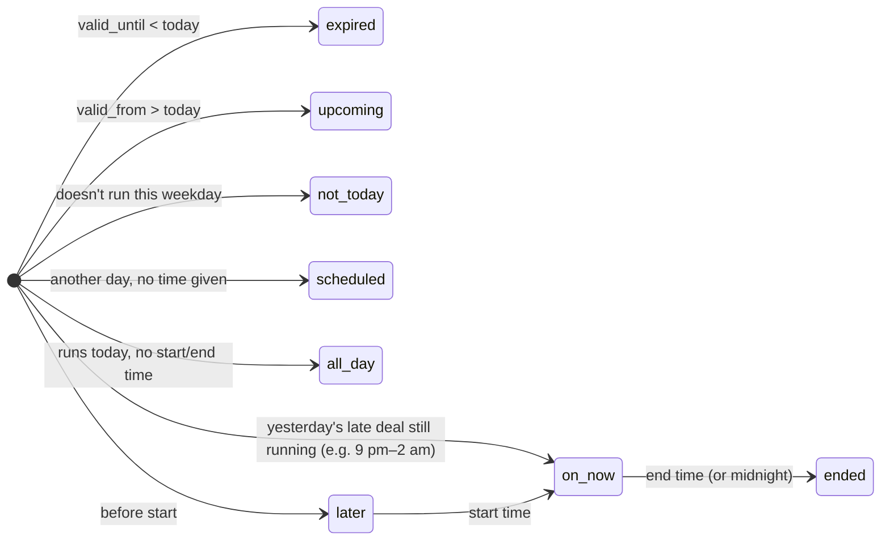
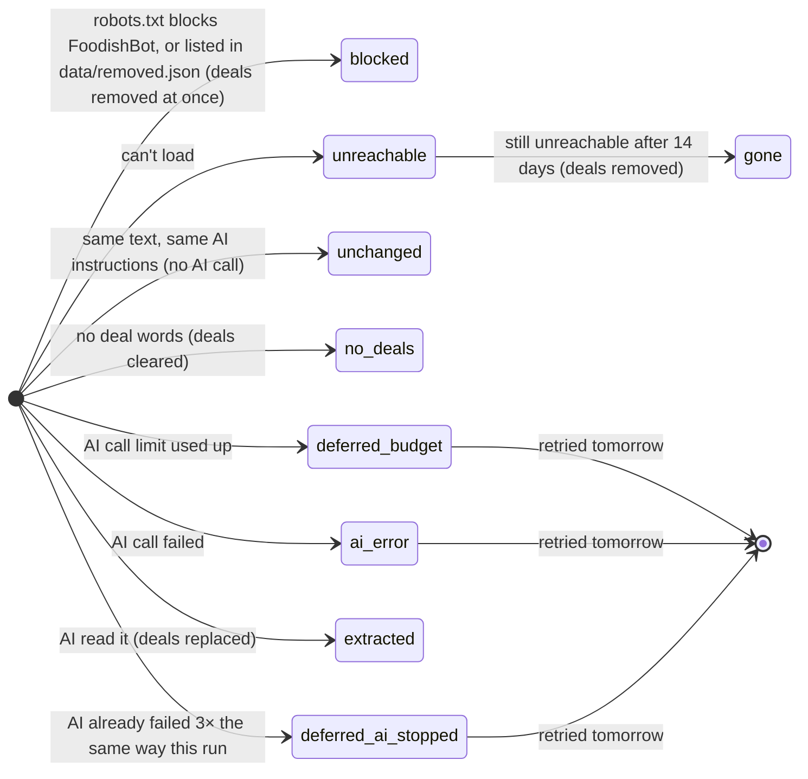
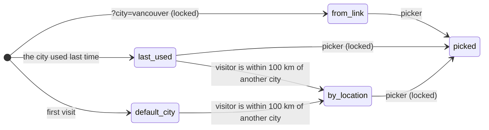

# Foodish state machines

Every part of Foodish that moves through stages, with its states named, the one place that
changes it, and the test that pins it down. If you're changing behaviour, change it here first.

| # | Machine | Lives in | Tested by |
|---|---------|----------|-----------|
| 1 | Deal timing (is it on now?) | `spec/deal-states.json` → `pipeline/deal_state.py` + `site/deal-state.js` | `tests/test_deal_state.py`, `tests/deal-state.test.mjs` |
| 2 | Website lifecycle (one site, one daily run) | `pipeline/site_state.py`, used by `pipeline/scrape.py` | `tests/test_site_state.py` |
| 3 | Run plan (what a workflow run does) | `pipeline/plan.py`, used by `.github/workflows/daily.yml` | `tests/test_plan.py` |
| 4 | Robot health (is the robot broken?) | `pipeline/health.py --gate` (last workflow step) | `tests/test_plan.py` |
| 5 | App data loading | `site/app.js` `setLoad()` | browser check (see below) |
| 6 | App location | `site/app.js` `setLocation()` | browser check |
| 7 | Alerts | `site/app.js` `alertsState()` / `syncAlertsBadge()`; `worker/worker.js` | browser check |
| 8 | Filters ↔ address bar | `site/app.js` `readLinkFilters()` / `writeLinkFilters()` | browser check |
| 9 | City (which city's deals are showing) | `site/app.js` `setCity()`; list in `cities.json` | `tests/test_cities.py`, browser check |
| 10 | Look (Daylight or Blue Hour) | `site/sky.js` `lookAt()`, applied by `site/app.js` `applyLook()` | `tests/sky.test.mjs`, browser check |

Run everything: `python -m unittest discover -s tests && node --test tests/*.test.mjs`

---

## 1. Deal timing

The rule every screen, page and alert uses to decide whether a deal counts. **The rules are data**:
`spec/deal-states.json` lists the states and 31 worked examples; the Python and browser versions must
both pass every one, so they can't drift. Any other app that reads `data/deals.json` (such as the
live foodish.ca app built in Grok) should follow the same file. `deals.json` links to it under `rules`.

- A deal with only an end time ("lunch until 4 pm") is taken to start 4 hours before it ends, no later than 11:00 (`start_of()` / `startOf()`). Before that it is `later`, not `on_now`.
- `all_day` is **never** "on now": we don't know the restaurant's hours. (Before this change the
  repo's app showed all-day deals as "on now" at 2 am; the live Grok app already had the right rule.)
- **Each city's clock:** deal times are in the deal's own city. Alberta has stayed on UTC-6 and British
  Columbia on UTC-7 year-round since 2026. Many devices' time-zone data still expect a November clock
  change, which would put every "on now" an hour off, so both versions use the fixed offsets
  (`now_in(zone)` / `zonedNow(zone)`).
- Display order on today's list: `on_now`, `later`, `all_day`, `ended`.

## 2. Website lifecycle

What happens to one restaurant website on a daily run. `site_state.next_step()` decides; `scrape.py`
does it and writes the outcome to `data/cache/report.json` (`sites.<domain>.outcome`, totals in
`outcome_counts`). The health summary shows the totals.

"Retried tomorrow" works because a site's text fingerprint is only saved after the AI has read it.
Deferred and failed sites keep their old deals. Cached deals whose `valid_until` has passed are now
dropped when publishing; they used to linger until the website changed.

## 3. Run plan

`pipeline/plan.py` turns *(event, cron, manual task, is the restaurant list empty, how old are the
deals)* into three yes/no jobs: `discover`, `scrape`, `notify`. Workflow steps only read
`steps.plan.outputs.*`; no cron strings are repeated in `if:` lines.

| Trigger | discover | scrape | notify |
|---|---|---|---|
| Manual `scrape` from the exact 4 am trigger (`worker/cron`) | if list empty | yes | no |
| `17 10 * * *` daily (4:17 am) | if list empty | yes, unless refreshed in the last 3 h (the 4 am trigger ran) | no |
| `47 11 * * *`, `23 13 * * *` backups | if list empty | only if deals are 12 h+ old | no |
| `45 21 * * *` alerts (3:45 pm) | if list empty | no | yes |
| `5 9 * * 0` weekly (Sun 3:05 am) | yes | yes | no |
| Manual `all` | yes | yes | yes |
| Manual `discover` / `scrape` / `notify` / `pages` | that job only (`scrape` also discovers if the list is empty) | | |

Search pages and the health summary run on every run. An unknown cron or task is an error, not a
silent no-op. `tests/test_plan.py` checks the table against a copy of the old workflow logic and that
`daily.yml` and `SCHEDULES` list the same crons.

## 4. Robot health

`healthy` → `broken`. After everything has saved and published, the last workflow step runs
`health.py --gate`. If today's refresh didn't finish, or the AI step stopped (bad key, no credit), the
run turns red and GitHub emails the owner, with the fix in the error. Before this, a run with a dead
AI key still showed a green tick (that happened every day from 22 Oct to 8 Nov 2026).

## 5–8. The app (`site/app.js`)

| Machine | States | Changes via | Notes |
|---|---|---|---|
| Data | `loading` → `ready` \| `error`; `error` → `loading` | `setLoad()` | Retry button; retries when back online or when the tab reopens; a failed refresh keeps the deals already shown; "last checked … over a day ago" when deals are 36 h+ old |
| Location | `locating` → `precise` \| `last_known` \| `default` | `setLocation()` | The location label is derived from the state |
| Alerts | `off` \| `on` \| `blocked` (derived, never stored twice) | `syncAlertsBadge()` | `blocked` = the visitor asked for alerts but the browser now refuses; nearby-watch stops |
| Submit | `idle` → `sending` → `sent` \| `error` | `submitDeal()` | Send is disabled while sending (the form is at the bottom of the page) |
| Filters | in the address bar | `readLinkFilters()` / `writeLinkFilters()` | `?cat=wings&day=3&now=1&view=map&km=1&q=tacos`: shareable, and opens the app in that state. `?look=day` / `?look=night` previews a look and is never saved |

Debug in the browser console: `__foodish.state`, `__foodish.alertsState()`.

Alert subscriptions (worker): `subscribed` → `unsubscribed` (visitor turns it off) or `expired`
(`notify.py` removes it when the push service answers 404/410). Admin endpoints stay locked unless
`ADMIN_TOKEN` is set.

## 9. City

Which city's deals are showing. One value (`state.city`), changed only by `setCity()`, which swaps the
data file, the centre, the clock and the labels together. The cities are data: `cities.json`.

- **Locked** (link or picker): the visitor's location no longer switches the city. If they're far from
  it, the location state is `away` and distances are measured from that city's centre.
- Visitors more than 100 km from every city stay on the current one and are told Foodish isn't in
  their area yet.
- The robot treats cities independently: the run plan (machine 3) is decided per city from that city's
  own files, each city has its own website lifecycle cache (machine 2), and the health gate
  (machine 4) checks every city that was refreshed. One city failing never blocks another.

## 10. Look

```mermaid
stateDiagram-v2
    direction LR
    night --> day: sunrise in the shown city
    day --> night: 30 minutes before sunset
    note right of day: Settings can fix either look; ?look= previews one without saving
```

`day` (Daylight) or `night` (Blue Hour), on `<html data-look>`. One function decides it (`wantedLook()`), one applies it (`applyLook()`).

- Sun times come from `sky.js` for the shown city's centre, on that city's clock (`deal_state` fixed offsets for Alberta and B.C.).
- Checked when the page opens, when the city changes, when the tab comes back, and each minute, but never applied within a minute of the visitor scrolling. Colours fade over one second (off with reduced motion).
- `index.html` sets the last look before anything draws, so the page doesn't flash the wrong colours.
- The look never changes what a deal *is*: lit = on now, outline = later today, blue band = all day, in both looks. Deals that have ended aren't shown.
